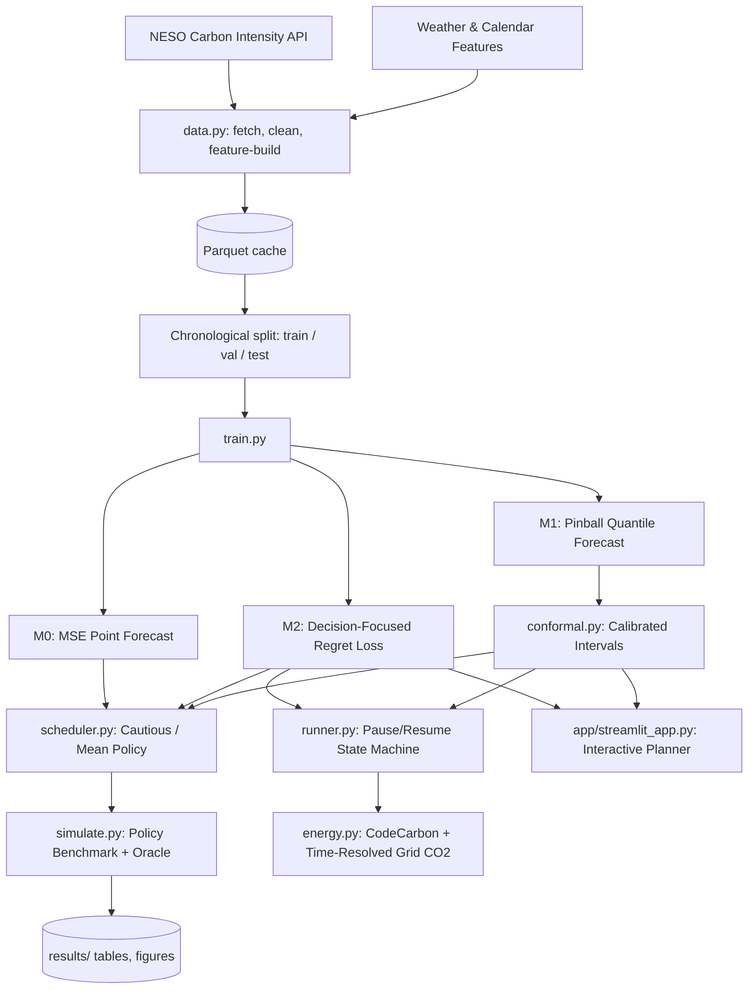

<<<<<<< HEAD
# Carbon-Aware Training: Decision-Focused Scheduling & Calibrated Forecasts

[](https://www.python.org/downloads/)
[](https://pytorch.org/)
[](LICENSE)

An end-to-end framework for carbon-aware deep learning workload scheduling on the UK electricity grid. Combines multi-rate pooling neural forecasters (N-HiTS), conformal uncertainty quantification, and decision-focused regret optimization to delay or pause/resume compute workloads during low-carbon grid windows.

---

## 1. System Architecture



---

## 2. Repository Layout

```
carbon-aware-training/
├── configs/                  # Modular YAML experiment configs
│   ├── data.yaml             # API, lookback, horizon, and split settings
│   ├── model.yaml            # N-HiTS block and pooling hyperparameters
│   ├── train_m0.yaml         # M0 MSE training configuration
│   ├── train_m1.yaml         # M1 Quantile pinball training configuration
│   ├── train_m2.yaml         # M2 Decision-focused regret configuration
│   ├── conformal.yaml        # Conformal prediction settings
│   ├── sim.yaml              # Job grid and simulation parameters
│   └── runner.yaml           # Pause/resume state machine settings
├── data/
│   ├── raw/                  # Cached API pulls
│   └── processed/            # Cleaned parquet series (is_imputed, is_valid)
├── src/
│   ├── __init__.py
│   ├── utils.py              # Seeds, metadata, git commit logging
│   ├── data.py               # NESO API ingestion, cleaning & synthetic generator
│   ├── features.py           # Cyclic calendar features & train-only scalers
│   ├── dataset.py            # Zero-copy index PyTorch Dataset & chronological splits
│   ├── models.py             # N-HiTS multi-rate forecaster & statistical baselines
│   ├── losses.py             # Pinball loss & soft-argmin decision regret
│   ├── train.py              # Modular training loop with checkpoint provenance
│   ├── conformal.py          # Conformalized Quantile Regression (CQR)
│   ├── scheduler.py          # Job abstraction & policy dispatcher (run-now, oracle, cautious)
│   ├── simulate.py           # Grid simulation with block-bootstrap confidence intervals
│   ├── energy.py             # CodeCarbon tracker & time-resolved grid CO2 calculation
│   └── runner.py             # Pause/resume state machine & atomic checkpointing
├── app/
│   └── streamlit_app.py      # Interactive Streamlit dashboard & horizon planner
├── checkpoints/              # Model weights and scaler artifacts
├── results/
│   ├── tables/               # Simulation metrics (main.csv, by_slack.csv, by_duration.csv)
│   ├── figures/              # Publication figures
│   └── logs/                 # Training epoch metrics and energy traces
├── tests/                    # Pytest verification suite
│   ├── test_data.py
│   ├── test_losses.py
│   ├── test_scheduler.py
│   ├── test_conformal.py
│   └── test_runner.py
├── notebooks/                # Exploratory notebooks
├── requirements.txt
├── Makefile
├── CONTRIBUTIONS.md
└── README.md
```

---

## 3. Quickstart

### 3.1 Installation

```bash
git clone <repo-url>
cd nndl-project
python -m pip install -r requirements.txt
```

### 3.2 Prepare Data

```bash
# Fetch from NESO API or generate synthetic dataset
python -c "from src.data import get_or_create_dataset; get_or_create_dataset()"
```

### 3.3 Run Unit Tests

```bash
python -m pytest tests/ -v
```

### 3.4 Train Forecasters

```bash
# Train M0: Baseline MSE point forecaster
python -m src.train --config configs/train_m0.yaml --model-type m0

# Train M1: Quantile forecaster for conformal bounds
python -m src.train --config configs/train_m1.yaml --model-type m1

# Train M2: Decision-focused regret-minimizing forecaster
python -m src.train --config configs/train_m2.yaml --model-type m2
```

### 3.5 Run Simulation Benchmark

```bash
python -m src.simulate --config configs/sim.yaml
```

Outputs will be saved in `results/tables/main.csv`, `by_slack.csv`, and `by_duration.csv`.

### 3.6 Launch Streamlit Horizon Planner

```bash
streamlit run app/streamlit_app.py
```

---

## 4. Method Highlights

- **N-HiTS Multi-Rate Pooling**: Hierarchical blocks pool input time series at multi-frequencies ($k \in \{8, 4, 1\}$), combining long-term backcast residuals with high-frequency forecast synthesis.
- **Decision-Focused Learning**: Rather than minimizing MSE, M2 minimizes the expected downstream carbon emission regret under soft-argmin policy selection:
  $$\mathcal{L}_{\text{decision}} = \mathbb{E}\left[ \sum_s p(s) W(s) - \min_s W(s) \right] + \lambda \cdot \text{MSE}$$
- **Conformal Calibration**: Computes horizon-specific non-conformity adjustments on the validation set, providing finite-sample valid coverage guarantees ($1 - \alpha$).
- **Pause/Resume Workload State Machine**: Dynamically shifts training across cheapest non-contiguous slots before deadline, with atomic checkpoints guaranteeing metric parity.

---

## 5. License

MIT License. See [LICENSE](LICENSE) for details.
=======
# GridWise
Carbon-Aware GPU Scheduling ; Forecasting Grid Carbon Intensity to Cut Training Emissions.
>>>>>>> 1ca7cb9d8173180b1c19667292560d84fe4a571c
