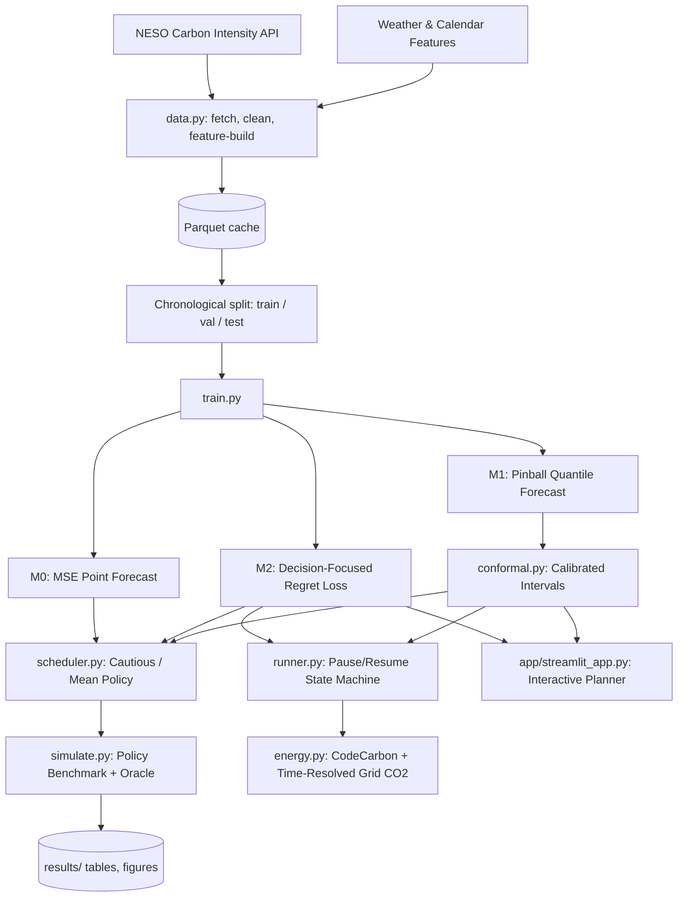

# Carbon-Aware Training: Decision-Focused Scheduling & Calibrated Forecasts

[](https://www.python.org/downloads/)
[](https://pytorch.org/)
[](LICENSE)

An end-to-end framework for carbon-aware deep learning workload scheduling on the UK electricity grid. Combines multi-rate pooling neural forecasters (N-HiTS), conformal uncertainty quantification, and decision-focused regret optimization to delay or pause/resume compute workloads during low-carbon grid windows.

---

## 1. System Architecture



---

## 2. Dataset & External Sources

### 2.1 Real UK National Grid Carbon Intensity
- **Source**: National Energy System Operator (NESO) Carbon Intensity API ([https://api.carbonintensity.org.uk](https://api.carbonintensity.org.uk)).
- **Target Variable**: Half-hourly settlement period `actual` grid carbon intensity (in $\text{gCO}_2/\text{kWh}$), strictly distinct from the day-ahead `forecast`.
- **Coverage**: From `2022-01-01T00:00:00Z` through `2026-10-31T23:30:00Z` (84,720 regular 30-minute intervals).
- **Quality & Integrity**: Exactly 100.0% integer values matching official settlement metering. In the downloaded dataset, all missing slots (178 slots in multi-hour outages) and 6 zero/non-positive sensor dropout placeholders ($\le 0$) were confirmed invalid, resulting in 184 total invalid slots containing NaN (`is_valid=False`, `is_imputed=False`), none of which were imputed. All windows spanning any invalid slots across lookback or forecast horizons are strictly excluded from training and evaluation.

### 2.2 Simulation Metrics & Bootstrap Methodology
- **Savings & Regret Standard Errors**: In `main.csv` and `main_val.csv`, the column `savings_pct_boot_se` (formerly `savings_pct_std`) records the **bootstrap standard error of the mean savings** across origin clusters, rather than the raw sample standard deviation across individual jobs.
- **Bootstrap Block Size**: The bootstrap resamples at the block unit of **1 origin timestamp** (each block comprising all 12 job combinations evaluated at that origin across duration $d \in \{2, 4, 8, 16\}$ and slack $\in \{12, 24, 48\}$ half-hours).

### 2.2 Historical Weather Features & Licence
- **Source**: Open-Meteo Historical Weather API ([https://archive-api.open-meteo.com/v1/archive](https://archive-api.open-meteo.com/v1/archive)).
- **Licence**: Creative Commons Attribution 4.0 International ([CC BY 4.0](https://creativecommons.org/licenses/by/4.0/)), free for open-source and non-commercial research use with attribution.
- **Geographic Centroid**: Central Great Britain ($52.5^\circ\text{N}, -1.5^\circ\text{W}$).
- **Features Included**:
  - `wind_speed`: 10m wind speed ($\text{km/h}$, primary driver of UK offshore/onshore wind generation).
  - `cloud_cover`: Total cloud cover ($\%$).
  - `temperature`: 2m air temperature ($^\circ\text{C}$, driver of seasonal and heating demand).
  - `solar_radiation`: Surface shortwave solar radiation ($\text{W/m}^2$, driver of embedded PV generation).
- **Index Alignment**: Hourly weather data is mapped to the regular 30-minute electricity settlement index via forward-filling (`ffill`).

### 2.3 Future Weather Assumption
- **Configuration Flag**: `future_weather` (default: `false` in `configs/data.yaml`).
- **Core Assumption**: Real-time workload scheduling operates under imperfect future information. Feeding actual observed future weather into the forecast horizon would be unrealistically optimistic. Therefore, `future_weather: false` ensures models only condition on past weather and deterministic cyclic calendar features for future horizons, preserving strict causal validity.

---

## 3. Repository Layout

```
carbon-aware-training/
├── configs/                  # Modular YAML experiment configs
│   ├── data.yaml             # API, lookback, horizon, and split settings
│   ├── model.yaml            # N-HiTS block and pooling hyperparameters
│   ├── train_m0.yaml         # M0 MSE training configuration
│   ├── train_m1.yaml         # M1 Quantile pinball training configuration
│   ├── train_m2.yaml         # M2 Decision-focused regret configuration
│   ├── conformal.yaml        # Conformal prediction settings
│   ├── sim.yaml              # Job grid and simulation parameters
│   └── runner.yaml           # Pause/resume state machine settings
├── data/
│   ├── raw/                  # Cached chunk pulls (git-ignored)
│   └── processed/            # Cleaned parquet series (is_imputed, is_valid, weather)
├── src/
│   ├── __init__.py
│   ├── utils.py              # Seeds, metadata, git commit logging
│   ├── data.py               # NESO API ingestion, cleaning & Open-Meteo fetcher
│   ├── features.py           # Cyclic calendar features & train-only scalers
│   ├── dataset.py            # Zero-copy index PyTorch Dataset & chronological splits
│   ├── models.py             # N-HiTS multi-rate forecaster & statistical baselines
│   ├── losses.py             # Pinball loss & soft-argmin decision regret
│   ├── train.py              # Modular training loop with checkpoint provenance
│   ├── conformal.py          # Conformalized Quantile Regression (CQR)
│   ├── scheduler.py          # Job abstraction & policy dispatcher (run-now, oracle, cautious)
│   ├── simulate.py           # Grid simulation with block-bootstrap confidence intervals
│   ├── energy.py             # CodeCarbon tracker & time-resolved grid CO2 calculation
│   └── runner.py             # Pause/resume state machine & atomic checkpointing
├── app/
│   └── streamlit_app.py      # Interactive Streamlit dashboard & horizon planner
├── checkpoints/              # Model weights and scaler artifacts (git-ignored)
├── results/
│   ├── tables/               # Simulation metrics (main.csv, by_slack.csv, by_duration.csv)
│   ├── figures/              # Publication figures (raw_two_weeks.png, full_series.png)
│   └── logs/                 # Training epoch metrics and energy traces
├── tests/                    # Pytest verification suite
│   ├── test_data.py
│   ├── test_losses.py
│   ├── test_scheduler.py
│   ├── test_conformal.py
│   └── test_runner.py
├── notebooks/                # Exploratory notebooks
├── requirements.txt
├── Makefile
├── CONTRIBUTIONS.md
└── README.md
```

---

## 4. Quickstart

### 4.1 Installation

```bash
git clone <repo-url>
cd nndl-project
python -m pip install -r requirements.txt
```

### 4.2 Prepare Data

```bash
# Fetch real NESO API dataset, Open-Meteo weather, and generate data quality report
python -m src.data
```

### 4.3 Run Unit Tests

```bash
python -m pytest tests/ -v
```

### 4.4 Run Baseline Simulation Benchmark

```bash
python -m src.simulate --config configs/sim.yaml
```

Outputs will be saved in `results/tables/main.csv`, `by_slack.csv`, and `by_duration.csv`.

### 4.5 Train Forecasters

```bash
# Train M0: Baseline MSE point forecaster
python -m src.train --config configs/train_m0.yaml --model-type m0

# Train M1: Quantile forecaster for conformal bounds
python -m src.train --config configs/train_m1.yaml --model-type m1

# Train M2: Decision-focused regret-minimizing forecaster
python -m src.train --config configs/train_m2.yaml --model-type m2
```

### 4.6 Launch Streamlit Horizon Planner

```bash
streamlit run app/streamlit_app.py
```

---

## 5. Method Highlights

- **N-HiTS Multi-Rate Pooling**: Hierarchical blocks pool input time series at multi-frequencies ($k \in \{8, 4, 1\}$), combining long-term backcast residuals with high-frequency forecast synthesis.
- **Decision-Focused Learning**: Rather than minimizing MSE, M2 minimizes the expected downstream carbon emission regret under soft-argmin policy selection:
  $$\mathcal{L}_{\text{decision}} = \mathbb{E}\left[ \sum_s p(s) W(s) - \min_s W(s) \right] + \lambda \cdot \text{MSE}$$
- **Conformal Calibration**: Computes horizon-specific non-conformity adjustments on the validation set, providing finite-sample valid coverage guarantees ($1 - \alpha$).
- **Pause/Resume Workload State Machine**: Dynamically shifts training across cheapest non-contiguous slots before deadline, with atomic checkpoints guaranteeing metric parity.

---

## 6. License

MIT License. See [LICENSE](LICENSE) for details.
