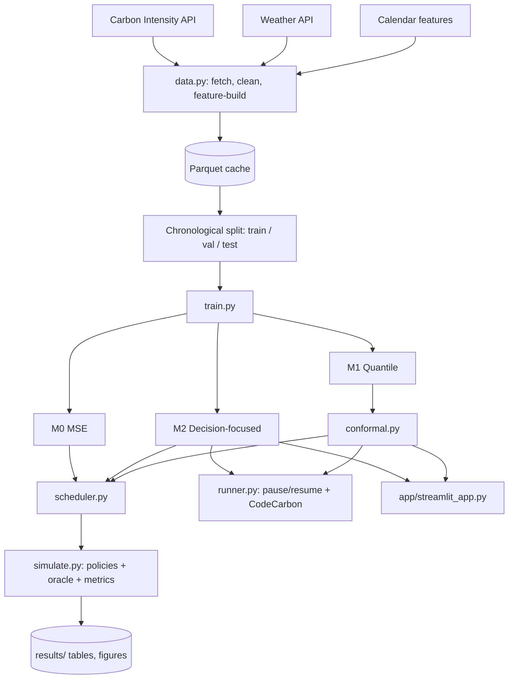
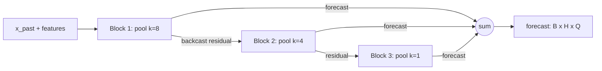
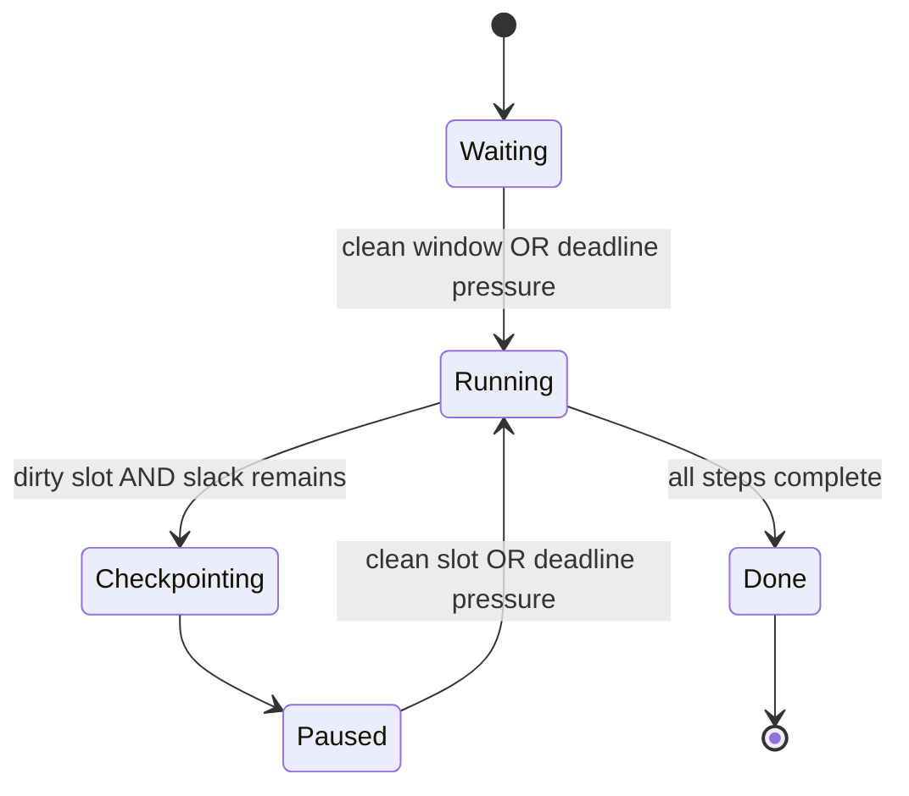

# Carbon-Aware Training: Technical Architecture

Companion to `carbon-aware-training-project.md`. This file covers only the engineering: components, data flow, tensor shapes, algorithms, interfaces, configs, testing, and deployment.

All code is a starting sketch. Test shapes, masking, scaling, and edge cases yourself.

---

## 1. Architecture at a glance



Layers:

| Layer | Modules | Responsibility |
|---|---|---|
| Data | `data.py`, `features.py` | Fetch, clean, feature engineering, windowing |
| Model | `models.py`, `losses.py`, `train.py` | Forecasters and training |
| Uncertainty | `conformal.py` | Calibrated intervals |
| Decision | `scheduler.py`, `simulate.py` | Policies, oracle, evaluation |
| Execution | `runner.py`, `energy.py` | Real pause/resume jobs and energy accounting |
| Presentation | `app/streamlit_app.py`, `notebooks/` | Demo and figures |

---

## 2. Technology stack

| Need | Choice |
|---|---|
| Language | Python 3.10+ |
| Deep learning | PyTorch (plain `nn.Module`, own training loop) |
| Data | pandas, NumPy, PyArrow (Parquet) |
| HTTP | `requests` with retry/backoff |
| Metrics and utilities | scikit-learn, SciPy |
| Energy | CodeCarbon |
| Demo | Streamlit |
| Plots | Matplotlib (static figures), Plotly (app) |
| Config | YAML via OmegaConf or plain `yaml` |
| Tracking | CSV/JSON logs, optional TensorBoard |
| Tests | pytest |
| Version control | Git, GitHub |

Pin versions in `requirements.txt`. Record them in the report.

---

## 3. Repository layout

```
carbon-aware-training/
├── configs/
│   ├── data.yaml
│   ├── model.yaml
│   ├── train_m0.yaml
│   ├── train_m1.yaml
│   ├── train_m2.yaml
│   ├── conformal.yaml
│   ├── sim.yaml
│   └── runner.yaml
├── data/
│   ├── raw/
│   └── processed/
├── src/
│   ├── __init__.py
│   ├── data.py
│   ├── features.py
│   ├── dataset.py
│   ├── models.py
│   ├── losses.py
│   ├── train.py
│   ├── conformal.py
│   ├── scheduler.py
│   ├── simulate.py
│   ├── energy.py
│   ├── runner.py
│   └── utils.py
├── app/
│   └── streamlit_app.py
├── checkpoints/
├── results/
│   ├── tables/
│   ├── figures/
│   └── logs/
├── tests/
│   ├── test_data.py
│   ├── test_losses.py
│   ├── test_scheduler.py
│   ├── test_conformal.py
│   └── test_runner.py
├── notebooks/
├── requirements.txt
├── Makefile
├── CONTRIBUTIONS.md
└── README.md
```

---

## 4. Data layer

### 4.1 Fetching (`data.py`)

- Endpoint: the National Energy System Operator Carbon Intensity API, national half-hourly intensity.
- The API limits history requests to 14 days, so loop over consecutive windows.

```python
import pandas as pd, requests, time
from datetime import timedelta

def fetch_range(start, end, base_url, session=None, chunk_days=14, pause=0.3):
    s = session or requests.Session()
    frames, cur = [], start
    while cur < end:
        nxt = min(cur + timedelta(days=chunk_days), end)
        url = f"{base_url}/{cur:%Y-%m-%dT%H:%MZ}/{nxt:%Y-%m-%dT%H:%MZ}"
        for attempt in range(5):
            r = s.get(url, timeout=30)
            if r.status_code == 200:
                break
            time.sleep(2 ** attempt)
        r.raise_for_status()
        frames.append(parse_response(r.json()))
        cur = nxt
        time.sleep(pause)
    df = pd.concat(frames).drop_duplicates("timestamp").sort_values("timestamp")
    return df
```

Check the exact endpoint format and response fields in the official API documentation. Do not trust the sketch's URL format.

### 4.2 Cleaning rules

1. Force a regular 30-minute index (`reindex` + `asfreq`).
2. Count missing slots. Linearly interpolate gaps of at most 2 slots; mark longer gaps as invalid and exclude windows that cross them.
3. Drop duplicates, keep the last.
4. Clip physically impossible values (negative intensity) and log the count.
5. Use UTC timestamps throughout. Handle the UK clock change only through UTC.
6. Save `processed/intensity.parquet` with a column `is_imputed`.

### 4.3 Features (`features.py`)

| Group | Features |
|---|---|
| Target | `intensity` |
| Calendar | `sin/cos(hour)`, `sin/cos(day_of_week)`, `sin/cos(day_of_year)`, `is_holiday`, `is_weekend` |
| Weather (hourly, forward-filled to 30 min) | wind speed, cloud cover, temperature, solar radiation |
| Lag context | handled by the lookback window, not manual lags |

**Leakage rule for forecasting:** future weather features come from *forecast weather* in a real deployment, but historical datasets contain *observed* weather. For the project, using observed future weather is an optimistic assumption. State this in the limitations, or run a variant with no future weather (past weather only) and compare.

Calendar features are known in advance and may be used for the future part of the window.

### 4.4 Splits

```
|<-------- train (~70%) -------->|<-- val (~15%) -->|<-- test (~15%) -->|
```

- Strictly chronological. Leave a gap of one horizon (48 h) between splits to avoid window overlap leaking.
- Fit scalers (mean/std on intensity and weather) on train only. Save them with the checkpoint.

### 4.5 Windowing (`dataset.py`)

| Tensor | Shape | Description |
|---|---|---|
| `x_past` | `(B, L, F_past)` | `L = 336`, past intensity + past features |
| `x_future` | `(B, H, F_future)` | `H = 96`, calendar (+ optional weather) for the horizon |
| `y` | `(B, H)` | true intensity for the horizon |
| `mask` | `(B, H)` | 1 if slot valid (not across a long gap) |

One sample per half-hour origin `t`: past = `[t-L, t)`, future = `[t, t+H)`. Use a PyTorch `Dataset` with an index array rather than materialising every window. Batch size 128 to 512 is fine for this data size.

---

## 5. Model layer

### 5.1 Forecaster (`models.py`)

Compact N-HiTS-style model: a stack of blocks, each block pools its input at a different rate, runs an MLP, and outputs a backcast and an interpolated forecast.



| Hyperparameter | Start value |
|---|---|
| Blocks | 3 |
| Pooling kernels | `[8, 4, 1]` |
| Hidden width | 256 |
| MLP layers per block | 2 |
| Dropout | 0.1 |
| Output size `Q` | 1 for M0 and M2, 3 (q = 0.05, 0.5, 0.95) for M1 |
| Parameters | roughly 1 to 3 million |

Skeleton:

```python
import torch, torch.nn as nn, torch.nn.functional as F

class Block(nn.Module):
    def __init__(self, L, H, F_in, pool, hidden, Q, drop):
        super().__init__()
        self.pool = pool
        self.L, self.H, self.Q = L, H, Q
        in_dim = (L // pool) * F_in
        self.mlp = nn.Sequential(
            nn.Linear(in_dim, hidden), nn.ReLU(), nn.Dropout(drop),
            nn.Linear(hidden, hidden), nn.ReLU(),
        )
        self.back = nn.Linear(hidden, L)
        self.fore = nn.Linear(hidden, (H // pool + 1) * Q)

    def forward(self, x):                       # x: (B, L, F_in)
        z = F.avg_pool1d(x.transpose(1, 2), self.pool).transpose(1, 2)
        h = self.mlp(z.flatten(1))
        backcast = self.back(h)                 # (B, L)
        coarse = self.fore(h).view(x.size(0), -1, self.Q)   # (B, H/pool+1, Q)
        forecast = F.interpolate(coarse.transpose(1, 2), size=self.H,
                                 mode="linear", align_corners=False).transpose(1, 2)
        return backcast, forecast               # (B, H, Q)
```

The full model concatenates `x_past` channels, feeds the intensity channel through the residual stack, and adds future features through a small projection added to the hidden state. Keep it simple first: a version using only the intensity history plus calendar features is enough to get results, then add weather.

### 5.2 Baselines

```python
def persistence(x_past, H):        return x_past[:, -1:, 0].repeat(1, H)
def same_time_yesterday(x_past, H): return x_past[:, -48:, 0].repeat(1, H // 48 + 1)[:, :H]
def same_time_last_week(x_past, H): return x_past[:, -336:-336 + H, 0]
```

Check the lookback is long enough for last-week indexing. Write unit tests.

### 5.3 Model variants

| ID | Output | Loss |
|---|---|---|
| M0 | `(B, H, 1)` | MSE |
| M1 | `(B, H, 3)` | Pinball at q in {0.05, 0.5, 0.95} |
| M2 | `(B, H, 1)` | Decision loss + λ·MSE |
| M3 (optional) | LSTM encoder-decoder or PatchTST | MSE |

---

## 6. Loss functions (`losses.py`)

### 6.1 Pinball

```python
def pinball(pred, y, quantiles):          # pred: (B,H,Q), y: (B,H)
    q = torch.tensor(quantiles, device=pred.device).view(1, 1, -1)
    e = y.unsqueeze(-1) - pred
    return torch.maximum(q * e, (q - 1) * e).mean()
```

### 6.2 Decision-focused soft-argmin regret

Definitions: `d` job length in slots, `W_hat_s` forecast window cost, `W_s` true window cost.

```python
def window_sums(x, d):                    # (B, T) -> (B, T-d+1)
    return F.avg_pool1d(x.unsqueeze(1), d, stride=1).squeeze(1) * d

def start_mask(T, d, slack, device):      # allowed starts s in [0, slack]
    n = T - d + 1
    idx = torch.arange(n, device=device)
    return idx <= slack                   # (n,)

def decision_loss(pred, y, d_list, slack_list, tau=5.0, lam=0.1):
    total, n_terms = 0.0, 0
    for d in d_list:
        W_hat = window_sums(pred, d)
        W = window_sums(y, d)
        for slack in slack_list:
            m = start_mask(pred.size(1), d, slack, pred.device)
            Wh = W_hat.masked_fill(~m, float("inf"))
            Wt = W.masked_fill(~m, float("inf"))
            p = torch.softmax(-Wh / tau, dim=1)
            exp_cost = (p * W.masked_fill(~m, 0.0)).sum(1)
            regret = (exp_cost - Wt.min(1).values).mean()
            total, n_terms = total + regret, n_terms + 1
    return total / n_terms + lam * F.mse_loss(pred, y)
```

Implementation notes:

- Scale intensities (for example divide by 100) so `tau` is meaningful. Report `tau` in scaled units.
- `softmax` over `-inf` entries is fine as long as at least one start is valid. The "run now" slot `s = 0` is always valid.
- Because the first slot is always allowed, `slack = 0` gives zero regret by construction; use slack of at least 12 slots (6 h).
- Sample `(d, slack)` pairs per batch rather than looping over all pairs, to save time.
- Optional temperature annealing: `tau = tau0 * (tau_min / tau0) ** (epoch / n_epochs)`.
- Optional ablation: pairwise margin ranking loss on window pairs.

### 6.3 Combined M2 schedule

Warm up with MSE for the first few epochs (`lam` large), then shift toward the decision term. This stabilises early training.

---

## 7. Training (`train.py`)

| Setting | Start value |
|---|---|
| Optimiser | AdamW, lr 1e-3, weight decay 1e-4 |
| LR schedule | Cosine or ReduceLROnPlateau |
| Epochs | 30 to 60 with early stopping (patience 5) |
| Batch size | 256 |
| Gradient clipping | 1.0 |
| Mixed precision | `torch.autocast` if GPU supports it |
| Early-stopping metric | Validation MAE for M0/M1; validation **regret** for M2 |
| Seeds | 5 minimum, fixed list in config |

Loop outline:

1. Seed everything (`torch`, `numpy`, `random`), set deterministic flags where feasible.
2. Build datasets and loaders (no shuffling across the split boundary; shuffling within train windows is fine).
3. For each epoch: train, validate, log metrics to CSV, save best checkpoint.
4. Save checkpoint dict: model state, config, scaler stats, seed, git commit hash, library versions.

Log per epoch: train loss, val MAE, val RMSE, val regret (for a fixed set of validation jobs), learning rate, time.

---

## 8. Conformal layer (`conformal.py`)

Conformalized quantile regression on M1 outputs `(q_lo, q_med, q_hi)` with `q_lo = 0.05`, `q_hi = 0.95` (nominal 90%).

Algorithm:

1. On the calibration set (validation period, not used for gradient training), compute per-horizon scores:
   `s_{i,h} = max(q_lo_{i,h} - y_{i,h}, y_{i,h} - q_hi_{i,h})`
2. For each horizon `h`, `Q_h` = the `ceil((n+1)(1-alpha)) / n` empirical quantile of `s_{·,h}`.
3. Calibrated interval: `[q_lo - Q_h, q_hi + Q_h]`.
4. On test data, compute empirical coverage per horizon and average width.

```python
import numpy as np

def conformal_offsets(q_lo, q_hi, y, alpha=0.1):     # arrays (N, H)
    scores = np.maximum(q_lo - y, y - q_hi)
    n = scores.shape[0]
    level = min(1.0, np.ceil((n + 1) * (1 - alpha)) / n)
    return np.quantile(scores, level, axis=0, method="higher")   # (H,)

def apply_offsets(q_lo, q_hi, Q):
    return q_lo - Q, q_hi + Q
```

Extensions (optional):

- **Rolling recalibration:** recompute `Q_h` on the most recent N weeks to handle drift.
- **Adaptive conformal inference:** update the miscoverage level online based on recent errors.

Window-level uncertainty: for cautious scheduling, form an upper bound of window cost as the sum of upper interval endpoints over the window. This is conservative (it ignores correlation between slots), which is fine for a first version; note it in the report.

---

## 9. Scheduler and simulation

### 9.1 Scheduler (`scheduler.py`)

```python
import numpy as np

def pick_start(forecast, d, slack, mode="mean", upper=None):
    """forecast: (H,) mean path, d: slots, slack: max delay in slots."""
    series = upper if (mode == "cautious" and upper is not None) else forecast
    costs = np.convolve(series, np.ones(d), mode="valid")   # (H-d+1,)
    costs = costs[: slack + 1]
    return int(np.argmin(costs))
```

Policies implemented behind one interface `policy(origin_idx, job) -> start_offset`:

| Policy | Start rule |
|---|---|
| `run_now` | 0 |
| `persistence`, `yesterday`, `last_week` | `pick_start` on baseline forecast |
| `m0`, `m1_median`, `m2` | `pick_start` on the model's mean/median path |
| `m1_cautious` | `pick_start` using conformal upper bound |
| `oracle` | `pick_start` on true series |

Optional tie-break: prefer an earlier start if costs differ by less than a small epsilon, to avoid pointless delays.

### 9.2 Job model

```python
@dataclass
class Job:
    d: int          # duration in slots
    power_kw: float
    slack: int      # max delay in slots
```

Emissions: `E(s) = power_kw * 0.5 * sum(c[t0+s : t0+s+d])` in gCO₂ (intensity is gCO₂/kWh, slot length 0.5 h).

### 9.3 Simulation (`simulate.py`)

1. Precompute forecasts for every test origin and every model once (batched inference), store as arrays.
2. For each origin, sample jobs from a fixed grid: `d ∈ {2, 4, 8, 16}` slots (1 to 8 h) and `slack ∈ {12, 24, 48, 96}` slots (6 to 48 h). Evaluating the full grid for every origin is cheap.
3. Skip origins whose job window would exceed the test period or cross invalid gaps.
4. For each policy compute `E`, savings vs run-now, regret vs oracle, and a `bad_delay` flag (`E(policy) > E(run_now)`).
5. Aggregate by policy, by `d`, by `slack`. Bootstrap confidence intervals by resampling origins in blocks (for example daily blocks) since neighbouring origins are correlated.

Outputs: `results/tables/main.csv`, `by_slack.csv`, `by_duration.csv`, plus figures.

---

## 10. Execution layer: pause/resume runner

### 10.1 State machine



### 10.2 Decision rule

At each decision interval (for example every 30 simulated minutes):

```
remaining_work = steps_left * time_per_step
time_left = deadline - now
must_run = (remaining_work >= time_left - safety_margin)

if must_run: run
else: run only if current slot is among the chosen cleanest slots
```

The chosen slots come from one of:

- **Threshold rule:** run when forecast intensity is below the q-th percentile of the next 48 h.
- **Planned slots:** choose the cheapest `k` slots (not necessarily contiguous) before the deadline, where `k = ceil(remaining_work / slot_length)`. Because pause/resume allows non-contiguous execution, this is a stronger policy than a single contiguous window. Compare both.

### 10.3 Checkpointing

Save: model state, optimizer state, scheduler state, epoch/step, RNG states (torch CPU/CUDA, NumPy, Python), dataloader position (or restart the epoch at a clean boundary), and the running metric log. Use atomic writes (write to temp file, then rename). Verify that a paused-and-resumed run reaches the same final metric as an uninterrupted run (within seed noise); this is a correctness test.

### 10.4 Clocks

| Mode | Clock | Use |
|---|---|---|
| Simulated | Replays historical intensity; each "slot" is advanced after a fixed number of training steps | Evaluation, many repeated experiments |
| Real | Wall clock plus live forecast | Live demo only |

Make the clock an injected dependency so the same runner code serves both.

### 10.5 Overheads to measure

- Checkpoint save time and load time (seconds, joules)
- Idle GPU power while paused (model stays in memory or process exits? decide and document)
- Warm-up cost after resume (first steps slower, CUDA context re-creation if the process restarts)

Report **net** savings after subtracting these.

---

## 11. Energy accounting (`energy.py`)

Two measurements:

1. **Measured energy:** wrap the job (or each active segment) in a CodeCarbon `EmissionsTracker` with `measure_power_secs` small (for example 5). Log kWh per segment.
2. **Emissions with the grid's actual intensity:** for each active segment, `CO2 = kWh_segment * mean(intensity over that segment's real slots)`.

Notes:

- CodeCarbon also reports its own CO₂ estimate using a location-based factor. State that this is an average and use your time-resolved calculation for the headline number.
- Record GPU model, driver, CPU, RAM, tracking mode (machine vs process), and number of repeated runs.
- On Colab or shared GPUs, power attribution is less reliable. Say so in the report.
- Run at least 3 repetitions for continuous vs pause/resume, report mean ± std.

---

## 12. Streamlit app (`app/streamlit_app.py`)

Layout:

```
Sidebar:   job duration, deadline, power draw (kW), confidence level
Main:      1) 48 h forecast line + conformal band
           2) bar of window costs, best window highlighted
           3) metric cards: start-now emissions, best-window emissions, % saved
           4) table: top 5 start times
```

Data flow:

1. Load model weights, scalers, and conformal offsets at startup (`st.cache_resource`).
2. Load the latest 7 days of data: either from the live API or from a bundled cached sample (fallback so the demo never fails offline).
3. Run inference, apply offsets, compute window costs, display.

Keep inference on CPU in the app. The model is small.

---

## 13. Configuration

Example `configs/train_m2.yaml`:

```yaml
seed_list: [0, 1, 2, 3, 4]
data:
  lookback: 336
  horizon: 96
  future_weather: false
model:
  blocks: 3
  pool: [8, 4, 1]
  hidden: 256
  dropout: 0.1
  quantiles: null
loss:
  type: decision
  lam: 0.1
  tau: 5.0
  d_list: [2, 4, 8, 16]
  slack_list: [12, 24, 48, 96]
  anneal_tau: true
train:
  lr: 1.0e-3
  weight_decay: 1.0e-4
  epochs: 50
  batch_size: 256
  early_stop_patience: 5
  early_stop_metric: val_regret
```

Every result file should store the config hash and git commit.

---

## 14. Experiment matrix

| Experiment | Variable | Values | Selection set |
|---|---|---|---|
| E1 baselines | policy | persistence, yesterday, last-week | test |
| E2 M0 vs M1 vs M2 | loss | MSE, pinball, decision | test, after tuning on val |
| E3 decision loss sweep | `lam`, `tau` | `{0, 0.01, 0.1, 1}`, `{1, 5, 20}` | **validation only** |
| E4 conformal | alpha | 0.1 (also 0.2) | coverage on test |
| E5 cautious vs mean | mode | mean, cautious | test |
| E6 sensitivity | slack, duration | grid in section 9.3 | test |
| E7 pause/resume | non-contiguous vs contiguous | simulated clock | simulated test period |
| E8 real run | continuous vs pause/resume | CodeCarbon | a small number of real runs |
| E9 stress test | low-wind or high-intensity spells | selected subperiods | test |
| E10 (optional) | architecture | M3 | test |

Run each learned model with 5 seeds.

---

## 15. Testing plan

Unit tests (pytest):

- `test_data.py`: chunk loop covers the full range, no duplicate timestamps, regular index, imputation flag correct.
- `test_losses.py`: pinball matches a manual calculation; decision loss is 0 when `pred == y` up to the MSE term; gradient flows (no NaN); `slack = 0` gives zero regret.
- `test_scheduler.py`: oracle never has negative regret; `run_now` returns 0; start never exceeds slack.
- `test_conformal.py`: on synthetic exchangeable data, coverage is close to nominal.
- `test_runner.py`: deadline is always met; pause then resume reproduces uninterrupted training within tolerance; checkpoint round-trip restores RNG.

Integration test: a tiny synthetic series with a clear sinusoidal intensity pattern; the full pipeline should recover large savings and near-zero regret for the oracle.

---

## 16. Reproducibility

- Fixed seed lists, recorded in configs.
- `requirements.txt` with pinned versions, plus Python version.
- Checkpoint metadata: commit hash, config, library versions.
- `make data`, `make train`, `make simulate`, `make app` targets in the `Makefile`.
- Cache raw API pulls so results do not depend on the API being available later.
- Note that GPU nondeterminism may cause small differences across runs; this is another reason to report mean ± std.

---

## 17. Compute and runtime estimates

| Task | Rough size | Hardware |
|---|---|---|
| Data | 2 to 3 years half-hourly is roughly 35k to 53k rows | CPU |
| Training one forecaster | small MLP-based model, minutes on CPU, faster on GPU | CPU or free-tier GPU |
| Simulation | thousands of origins x job grid, vectorised | CPU |
| Real pause/resume job | a short ResNet-18 CIFAR-10 run | GPU needed for realistic energy measurements |

These are estimates, not measurements. Time the first run and adjust the plan.

---

## 18. Risks and mitigations

| Risk | Mitigation |
|---|---|
| API rate limits or downtime | Cache raw data, retry with backoff, pull early |
| Weather leakage (observed future weather) | Run a no-future-weather variant, state the assumption |
| Decision loss unstable | MSE warm-up, `tau` annealing, gradient clipping |
| Decision loss gives no gain | Report honestly; emphasise the conformal and system results |
| Conformal coverage drifts | Rolling recalibration, report coverage by horizon |
| Real GPU energy readings noisy | Repeat runs, report mean ± std, state hardware |
| Pause/resume changes training outcome | Verify metric parity; checkpoint RNG and optimizer state |
| Time shortage | Drop M3, ranking-loss ablation, live-API demo first |

---

## 19. Build order

1. `data.py` fetch and cache; plot the raw series.
2. Baselines plus `simulate.py` with `run_now`, baselines, and oracle (results available even before any deep model).
3. M0 training; plug into the simulator.
4. M1 training; add conformal layer and cautious policy.
5. M2 decision loss and sweep.
6. Runner (simulated clock first), then CodeCarbon real runs.
7. Streamlit app.
8. Figures, tables, report.

Having the simulator working with baselines early means every later model drops into an existing evaluation pipeline.

---

## 20. Deliverables checklist

- [ ] Cleaned dataset script and cache
- [ ] Baselines and oracle results
- [ ] M0, M1, M2 trained with 5 seeds
- [ ] Conformal coverage plots
- [ ] Sensitivity plots
- [ ] Pause/resume runner with tests
- [ ] CodeCarbon measurements (continuous vs pause/resume)
- [ ] Streamlit app with README screenshots or GIF
- [ ] Limitations section written honestly
- [ ] Contribution log
- [ ] Hard-copy report
